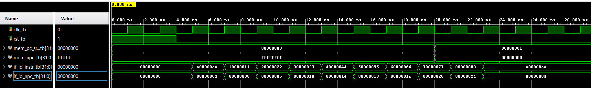

# Coding Assignment 1 - Fetch Stage
<!--
Replace every item in square brackets before submitting.
Keep this README focused on what the design does, how it is used, and how it was
verified.
-->

## Design Scope and Assumptions
- **In scope:** The purpose of this lab is to begin our MIPS pipeline with the first stage - fetch.
- **Out of scope:** The remaining stages of the MIPS pipeline will be implemented in future labs.
- **Assumptions:** Memory is byte-addressed, so each 32-bit instruction is 4 bytes and the PC advances by 4. The testbench clock toggles every 1 ns, and all clocked modules update on the rising edge.
- **Limitations:** Vivado cannot build a real 2^32 word array, so mem.v store only the first 64 byte addresses. The first 10 instructions hold dummy data, and every other address returns 0. Additionally, there is no stall or flush logic, os hazards are not handled in this stage.
- 
## Requirements
| Requirement | Description | Verification Method |
|---|---|---|
| Latch | Passes the data through on the clock cycle | Waveform: if_id_npc and if_id_instr change only on the rising clock edges and reset to 0 when rst is high |
| Instruction Memory | Holds 2^32 words, For now populate the first 10 addresses with Dummy Data, and Returns the instruction at a given address | Waveform: if_id_instr shows the HEX values for the PC values|
| PC | Passes the input as the output on the clock cycle | Waveform: pc_out takes the value of pc_in on each rising edge|
| Mux | Selects source of the next PC address | Waveform: with mem_pc_src = 1 the PC loads mem_mpc0 and with mem_pc_src = 0 it follows the adder |
| Adder | Calculates the address of the next sequential instruction by adding 4 to the current PC | Waveform: if_id_npc is always the current address and steps up each clock|
| Final IF Stage | Module with all 5 components | Incoporating all of the above in the full-stage testbench fetch-tb.v|

## Architecture
### Timing or Behavioral Summary


## Implementation
### Source Code
| File | Description |
|---|---|
| [`if_id_latch.v`](https://github.com/isabellalaurenn/codingAssignment1-IF/blob/main/if_id_latch.v) | Dictates when to move to the next instruction on clock edge. |
| [`mem.v`](https://github.com/isabellalaurenn/codingAssignment1-IF/blob/main/mem.v) | Reads instruction memory data at a specific location. |
| [`pc.v`](https://github.com/isabellalaurenn/codingAssignment1-IF/blob/main/pc.v) | Holds current state at clock edge. |
| [`mux.v`](https://github.com/isabellalaurenn/codingAssignment1-IF/blob/main/mux.v) | Decides where the processor will continue. |
| [`adder.v`](https://github.com/isabellalaurenn/codingAssignment1-IF/blob/main/adder.v) | Combinational logic calculating next sequential instruction address. |
| [`fetch.v`](https://github.com/isabellalaurenn/codingAssignment1-IF/blob/main/fetch.v) | [Verification testbench] |
| [`fetch_tb.v`](https://github.com/isabellalaurenn/codingAssignment1-IF/blob/main/fetch_tb.v) | [Verification testbench] |

### Implementation Notes
- [Explain one important design decision.]
- [Identify any parameterization, reusable module, or interface convention.]
- [Document any deliberate simplification made for this lab.]
- 
## Verification
### Verification Strategy
The design is verified using **timing diagrams**.
Verification covers:
- [Normal operating case]
- [Boundary or maximum-value case]
- [Reset or initialization case]
- [Invalid, stalled, or exceptional case, if applicable]
### Testbench and Waveform
Save screenshots and waveform images in the repository's `images/` folder.

The testbench source is available [*here*](LINK_TO_TESTBENCH_CODE).
### Results
| Test Case | Expected Result | Observed Result | Status |
|---|---|---|---|
| TC-01 — [Name] | [Expected behavior] | [Observed behavior] | Pass / Fail |
| TC-02 — [Name] | [Expected behavior] | [Observed behavior] | Pass / Fail |
| TC-03 — [Name] | [Expected behavior] | [Observed behavior] | Pass / Fail |

## Reproduction Instructions
### Tools and Versions
- **Simulator / synthesis tool:** Vivado
- **Language / standard:** Verilog
- **Operating system:** Windows
- **Additional dependencies:** n/a
### Build and Run
```bash
# Replace these commands with the commands required for this lab.
[compile-command]
[run-command]
```
Expected output:
```text
[Paste a short representative output or result here.]
```

## Repository Organization
```text
.
├── README.md
├── images/
│ ├── [timing-diagram-filename].png
│ └── [testbench-screenshot-filename].png
├── [source-files]
└── [testbench-files]
```

## Known Issues and Future Improvements
- [Document any known issue, unverified behavior, or technical debt.]
- [Describe a realistic improvement or extension.]
